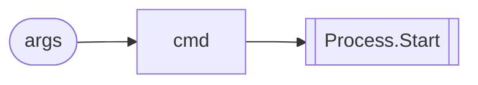

# Graph Export Formats

Dosai exports call graphs and data-flow graphs as Mermaid, GraphML, and GEXF.

## Choosing a format

| Format  | Best for                             | Notes                                          |
| ------- | ------------------------------------ | ---------------------------------------------- |
| Mermaid | Markdown, PR reviews, quick diagrams | Compact, readable, not ideal for large graphs  |
| GraphML | yEd, NetworkX, custom XML pipelines  | Rich attributes, directed graphs               |
| GEXF    | Gephi exploration                    | Rich attributes and interactive graph analysis |

## Call graph export

```bash
dotnet run --project ./Dosai -- methods \
  --path /repo \
  --o dosai.json \
  --callgraph-format graphml \
  --callgraph-out callgraph.graphml
```

Call graph edge model:

```text
Caller method node ── MethodCall/PropertySet/ConstructorCall ──► Target method node
```

Call graph node attributes:

- `id`
- `label`
- `kind`
- `file`
- `external`
- `purl`
- `reachableEntryPoints` (bounded list of entry-point ids that reach the node, schema 4.1.0)
- `minDepthFromEntryPoint` (minimum call distance from the nearest reachable entry point)
- `fanIn` / `fanOut` (distinct callers and callees)
- `inRecursiveCycle` (membership in a recursion cluster)
- `genericInstantiation` (original instantiated IL id when the node was normalized onto its source original definition)

Call graph edge attributes:

- `callType`
- `sourcePurl`
- `targetPurl`
- `location`
- `callSiteCount` (distinct call sites after same-pair edge collapsing, schema 4.1.0)
- `dispatchConfidence` (`exact`, `rta-candidate`, or `cha-candidate` for inferred virtual and interface edges)

## Data-flow export

```bash
dotnet run --project ./Dosai -- dataflows \
  --path /repo \
  --o dataflows.json \
  --graph-format gexf \
  --graph-out dataflows.gexf
```

Data-flow graph model:

```text
Source node ── Assignment/Expression/CallReturn ──► Transform node ── SinkArgument/SinkReceiver ──► Sink node
```

Data-flow node attributes:

- `kind`
- `symbol`
- `type`
- `purl`
- `file`
- `method`
- `line`
- `category`
- `source`
- `sink`
- `code`

Data-flow edge attributes:

- `kind`
- `label`
- `sourcePurl`
- `targetPurl`

## Mermaid examples



## Text escaping

Node ids, labels, and attribute values in the GraphML and GEXF exports are escaped by one shared escaper (`Dosai/XmlText.cs`). The five markup characters `<`, `>`, `&`, `'`, and `"` become the entity references `&lt;`, `&gt;`, `&amp;`, `&apos;`, and `&quot;`. Every character the XML 1.0 `Char` production rejects, that is control characters below U+0020 other than tab, newline, and carriage return, plus U+FFFE and U+FFFF, and every lone surrogate (a high or low surrogate without its partner), is replaced with U+FFFD (the Unicode replacement character). Identifiers, file names, and code text read from an analyzed tree can carry all of these; without the replacement the exported document would not parse with any conforming XML parser.

U+FFFD was chosen over a visible `\uXXXX` form because GraphML and GEXF define no such escape syntax, and replacement keeps downstream XML tooling working instead of presenting it with text it may or may not unescape. A complete surrogate pair (for example an emoji) is one supplementary character and is kept as-is. Text whose characters are all legal is escaped exactly as before, so exports of trees whose identifiers contain only legal characters are byte-identical to earlier releases. Mermaid labels use the separate, unchanged Mermaid escaper.

## Graph validation

The CI workflow validates that:

- every graph edge source exists as a node
- every graph edge target exists as a node
- GraphML/GEXF XML parses successfully

The vulnerable-repo smoke workflow additionally asserts minimum slice counts for intentionally vulnerable projects.
